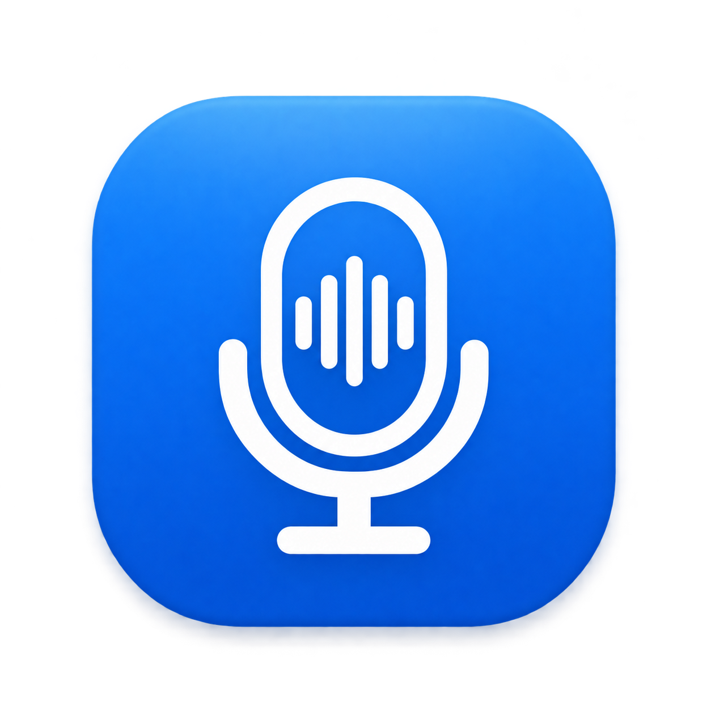

<p align="center"></p>

<h1 align="center">OpenVoice</h1>

<p align="center">macOS 菜单栏语音输入：在任意输入框里按住或点按快捷键说话，识别结果直接打到光标处。</p>

## 功能

- **四个识别渠道**：豆包输入法、微信输入法、千问输入法云端识别，以及完全本地运行的离线识别（仅 Apple 芯片），可在设置中切换
- **长按说话**：按住右 ⌥ / 右 ⌘ / 右 ⌃ / Fn 开始，松开结束
- **点按说话**：自定义快捷键（单个修饰键或任意组合键），点一下开始，停顿 1–5 秒自动结束，再点一下可提前结束；可关闭静音自动结束
- **长按并发送**：可绑定第二个长按快捷键，定稿上屏后自动回车发送；多渠道模式自动采用第一个无错误的非空定稿
- **边说边上屏**：识别中的文字实时打到光标处，结束后按定稿修正；关闭后改为结束时一次性粘贴
- **连续语音输入**：单渠道等待定稿或多渠道候选未关闭时可再次长按或点按继续说，各段按录音顺序合并，保留完整定稿和润色结果
- **多渠道候选**：原「全部」现为「多渠道（说完挑选）」，可选择至少两个识别渠道；实时显示候选，数字键或 ↑↓ 回车选择，确认未完成的候选会等到定稿，记住上次选择的渠道
- **预录保护**：按键按下即收音，长按确认后保留起始语音；取消短按会丢弃该次预录
- **麦克风选择**：可指定输入设备，设备断开时自动回落到系统默认
- **声波浮层**：收音时显示声波，松键后保留浮窗，切换为 `thinking` 和加载动画；完整定稿、润色完成后关闭
- **会议转写**：⌘⇧M 开始，持续收录麦克风和电脑播放的声音；可拖动的动态声波悬浮窗，点击展开转写、停止、复制与导出
- **会议自动回退**：优先当前渠道，失败、空结果或超时后用原音频切换备用渠道；全部失败的片段保留待补转，可恢复上次会议

## 安装

从 [Releases](../../releases) 下载 `OpenVoice-x.y.z.dmg`，打开后将 OpenVoice 拖到「应用程序」。

发布包为 ad-hoc 签名、未经 Apple 公证，首次运行前需解除隔离：

```bash
xattr -dr com.apple.quarantine /Applications/OpenVoice.app
```

要求 macOS 15+。通用包，Apple 芯片与 Intel 均可直接运行，无需安装任何依赖。

## 使用

1. 启动后出现在菜单栏（麦克风图标）。图标被刘海或菜单栏管理工具挡住时，再次打开 OpenVoice.app 即可弹出设置
2. 按提示授予 **辅助功能**（监听快捷键、上屏）和 **麦克风** 权限
3. 在设置中选择渠道、快捷键、麦克风，然后在任意输入框中说话

设置窗口按「识别渠道」「快捷键」「会议转写」「声音与界面」「权限」分为五页。渠道对比位于「识别渠道」页，可录音一次并比较各渠道的实际识别结果与耗时。

| 设置项 | 默认值 |
|---|---|
| 识别渠道 | 豆包输入法 |
| 长按快捷键 | 右 ⌥ |
| 点按快捷键 | 右 ⌘ |
| 长按并发送 | 右 ⌃ |
| 静音自动结束 | 开启，1.5 秒 |
| 边说边上屏 | 开 |
| 会议转写快捷键 | ⌘⇧M（可自定义） |

### 会议转写

1. 按 **⌘⇧M**，或菜单栏选择「开始会议转写」。首次使用需允许麦克风及「屏幕与系统音频录制」权限；系统音频用于收录线上会议对方的声音，不会保存屏幕画面。使用耳机可避免扬声器的声音被麦克风再次收录。
2. 悬浮窗显示收音动画和已录时长；**拖动顶部移动**，**点击顶部展开/收起**，再按快捷键也可展开/收起。收起、静音或切换应用都不会结束会议。
3. 展开后可查看带时间戳的转写。「暂停转写」停止收音并处理已录尾音，原位置切换成「恢复转写」；恢复后继续同一场会议，累计录音时长不包含暂停时间，导出文本中会记录暂停和恢复的时间。「退出」结束会议、保存未完成片段并关闭窗口。会议文字只出现在窗口中，不会打进当前输入框。
4. 可复制文字、导出 Markdown 或暂停后导出 WAV。菜单栏「打开会议记录」可查看历次记录，「恢复上次会议 / 补转」从本地音频恢复未完成片段。

会议悬浮窗使用浅色界面，展开/收起采用 0.32 秒缓动与淡入淡出；系统启用「减少动态效果」时直接切换。声波音量单独刷新，文字列表不随音量重排；已排版的内容在窗口动画期间保持固定尺寸。暂停时声波动画停止，恢复时继续。

会议优先使用当前识别渠道，失败时依次尝试其他可用渠道，已安装的本地离线模型也参与回退。「全部」在会议模式中使用自动回退，无需手动选结果。未完成片段每 30 秒自动重试，也可点击「立即重试」。

音频先写入 `~/Library/Application Support/OpenVoice/Meetings/<会议编号>/audio.pcm`，再提交给识别渠道。录音按连续的 5–18 秒片段接续，切片和重试期间持续收音，备用渠道从片段开头重放；临时文字按片段替换，定稿不会重复追加。最多并行处理三段，离线模型仅占用一个识别槽位。原始格式为 16kHz、单声道、16-bit little-endian PCM（约 115 MB/小时）；`session.json` 保存片段进度，`transcript.md` 保存可直接阅读的文字，未定稿段会标注「待补转」。记录由用户自行清理。

原音频保留用于故障补转，识别准确率仍受收音条件和渠道质量影响，不能保证逐字无误。收音权限、设备异常或磁盘写入失败会明确报错；电脑睡眠时会暂停录音，唤醒后点击「恢复转写」。

**离线识别**：首次选择「离线」渠道时会先询问是否下载引擎库（约 8MB，来自上游 [offline-libs](https://github.com/J3n5en/voicekey/releases/tag/offline-libs) Release）和模型（约 177MB，来自字节 CDN），保存在 `~/Library/Application Support/OpenVoice/offline/`。之后断网也能用；识别时会在后台进程中占用约 1GB 内存，空闲 5 分钟后自动释放，也可随时在设置中删除。

单个修饰键可同时作为长按键和点按键：快速点一下为点按，按住超过 0.3 秒为长按。设为组合键的点按快捷键会被 OpenVoice 拦截，不再传给前台应用。
长按并发送与长按快捷键一样通过选择器选择；如果与长按或点按快捷键冲突，会自动换到可用按键。识别渠道为「全部」时不会弹出选择浮层，会直接发送第一个返回的非空定稿。

## 从源码构建

```bash
./build.sh            # 产物在 build/OpenVoice.app（arm64 + x86_64 通用包）
```

- 只需 Xcode 命令行工具；Opus 由 `Scripts/opus.sh` 从官方源码编译为通用静态库，首次构建自动下载并校验
- 本地自动生成并复用 `OpenVoice Self-Signed` 固定签名证书；可用 `SIGN_IDENTITY` 指定证书，`-` 为 ad-hoc
- `VERSION` / `BUILD` 环境变量设置版本号
- 打包 DMG：`./Scripts/dmg.sh build/OpenVoice.dmg`（窗口布局与背景见 `Scripts/dmg/`）
- 调试识别链路：`build/OpenVoice.app/Contents/MacOS/OpenVoice --test doubao|wetype file.wav`
- 渲染会议窗口预览（不收音、不联网）：`build/OpenVoice.app/Contents/MacOS/OpenVoice --preview-meeting /tmp/openvoice-meeting-preview`
- 窗口性能测试（1000 段模拟记录、持续音量/文字更新和连续展开/收起）：`build/OpenVoice.app/Contents/MacOS/OpenVoice --preview-meeting /tmp/openvoice-meeting-benchmark --benchmark`
- 语音与音频回归基线（含快捷键预录、候选定稿确认、续录、连接复用，以及会议分片、回退、恢复和混音）：`./Scripts/test.sh`；见 [语音输入回归基线](docs/dictation-baseline.md) 与 [上游流程对齐契约](docs/dictation-parity.md)

## 发布

推送 `v*` 标签后，GitHub Actions 自动构建并创建 Release：

```bash
git tag v0.2.0 && git push origin v0.2.0
```

## 实现

| 文件 | 内容 |
|---|---|
| `Doubao.swift` | 豆包：设备注册、WebSocket + protobuf 流式识别 |
| `WeType.swift` | 微信：secp128r1 ECDH、AES-256-ECB、snappy、protobuf 流式识别 |
| `Offline.swift` | 离线：资源下载与校验、识别子进程管理 |
| `CHanbao/` | 在 macOS 进程内加载安卓 ELF 引擎库（ELF 加载器 + bionic 兼容层） |
| `Audio.swift` | AudioQueue 采集 16kHz 单声道、音量计算、设备枚举 |
| `MeetingRecorder.swift` | ScreenCaptureKit 电脑声音与麦克风收音，按时间戳混音 |
| `MeetingArchive.swift` / `MeetingPipeline.swift` | 会议音频持久化、连续分片、渠道回退和断点补转 |
| `MeetingSession.swift` / `MeetingPanel.swift` | 会议生命周期、可拖动悬浮窗与导出 |
| `System.swift` | 全局快捷键（CGEventTap）、上屏、HUD |
| `Core.swift` | Opus 编码、protobuf 编解码、WebSocket 封装 |
| `Scripts/icon.swift` | 将 `docs/icon.png` 生成各尺寸 App 图标 |

音频以 20ms 一帧 Opus 编码后上传。识别设备身份在本机运行时生成，保存在 `~/Library/Application Support/OpenVoice/`。

## 声明

本项目通过分析输入法客户端协议实现，仅供学习与个人使用，与字节跳动、腾讯无关。接口可能随时变更或失效；语音会发送到对应厂商的服务器。

## 致谢

本项目基于 [VoiceKey](https://github.com/J3n5en/voicekey) fork 而来，感谢原作者 [J3n5en](https://github.com/J3n5en) 的出色工作。
